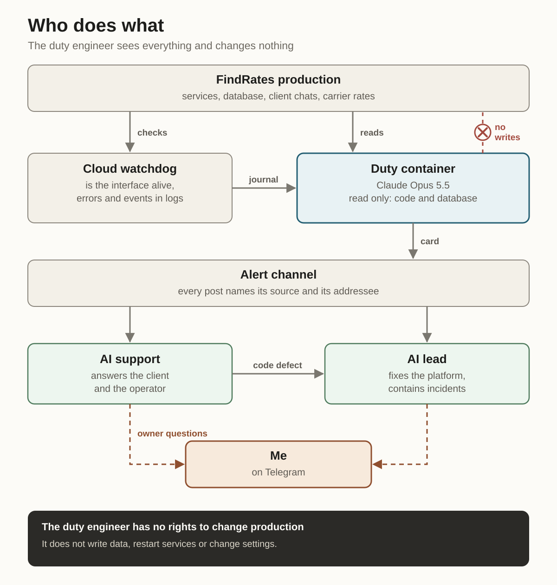
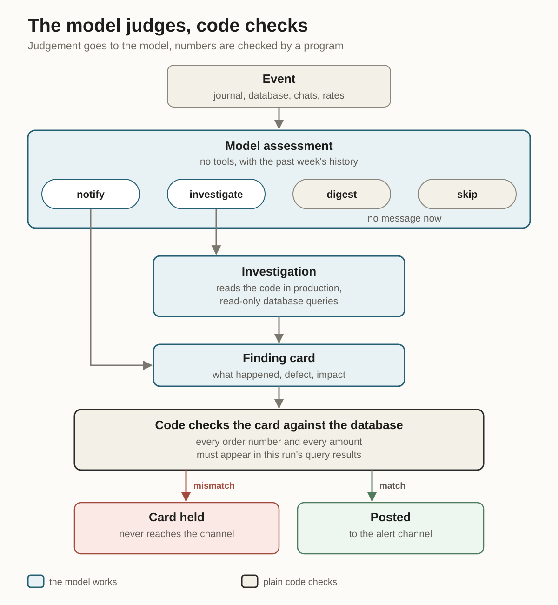
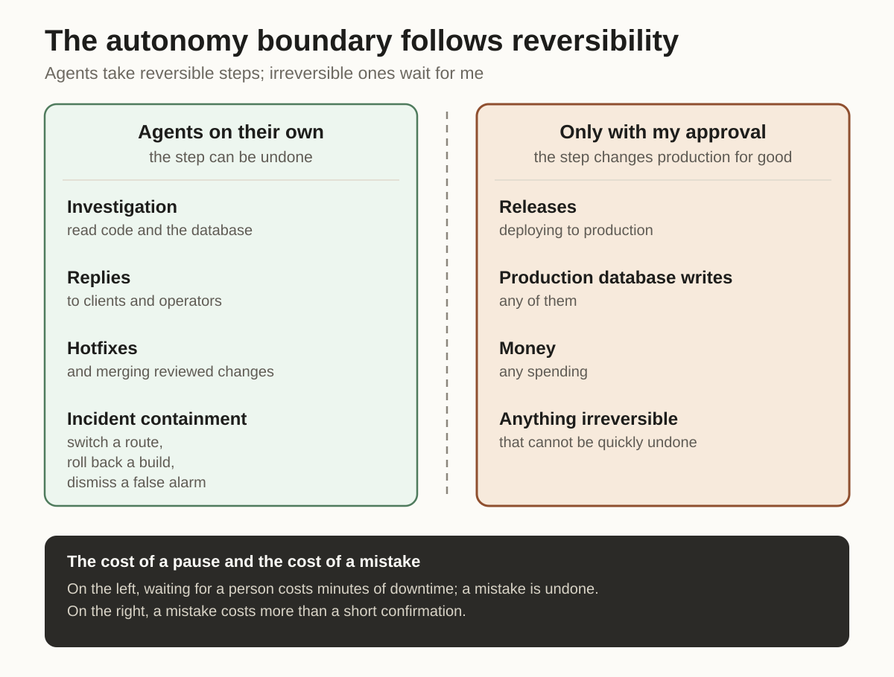
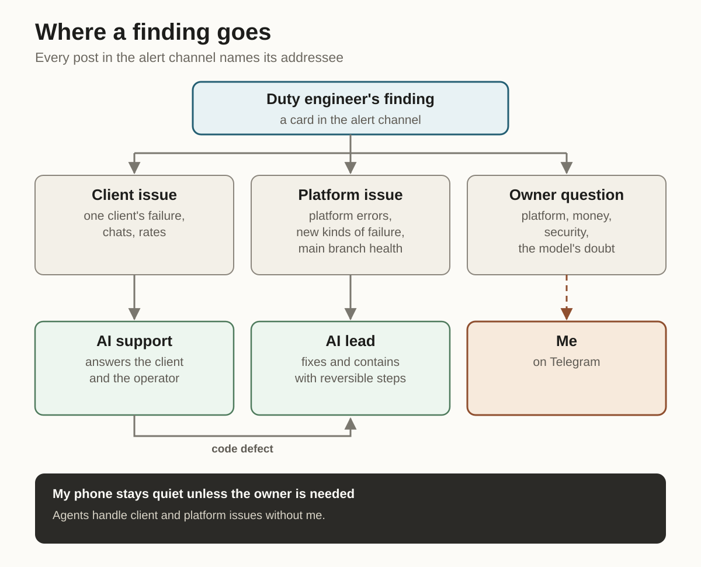

In a typical web service, an outage shows up on the charts right away: error codes climb, response latency grows or the job queue backs up. In products with complex domain logic, external integrations and conversational agents, the most expensive failures look different. Servers are healthy, responses are fast, the error log is empty, yet semantically the deal quietly falls through.

I lead engineering at FindRates, a freight shipping service. Clients message a bot in chat apps and by email, carriers send rates by email, and staff and partners work across three web interfaces. A one-off timeout followed by a clean retry leaves an error in the log even though the flow finished normally. Meanwhile, a bot stuck repeating the same question in chat or a misparsed condition in a carrier's rate produces no technical error at all and silently loses the client.

Threshold alerts watch numbers and miss what an operation means. Catching failures like these around the clock and closing routine issues without waking developers at night takes a system that can cross-check a line of dialogue, database state and the handler in code. At FindRates, this loop runs on Claude Opus 5.5 and specialized AI agents.

Below I break down the layers of that system and the principles behind an on-call shift where AI watches production and contains failures without the risk of breaking it.

## Six layers of semantic monitoring

The monitoring and response loop splits into six sequential layers, each with one job.

**Signal collection.** A single stream of infrastructure logs is not enough. The system brings together availability checks and deploy events, application errors from the product's own database, live client chats and the results of parsing incoming rates.

Writing errors straight to the application database duplicates the cloud log collector. When a major hosting outage blinded the external log stream for 22 hours and a storage failure broke saving client attachments (writes took 10 hours to restore, 8 hours of that waiting on builds at the provider), reading errors from our own database kept production visible.

**Initial assessment and noise suppression.** Sending the full stream into deep investigation is expensive and pointless. Hard rules first drop quiet ten-minute windows and known background noise. The remaining signals go through a fast pass by a pinned model with no tools: using a week of history on repeat occurrences, it separates a one-off glitch from a client failure or quiet platform degradation (a nightly job failing again, a growing queue, a rejected API key, an exhausted balance at an external service).

**Read-only investigation.** When the initial signal is not enough for a diagnosis, an isolated investigation pass opens. The model reads a code snapshot of the version running in production and runs read-only queries against the production database with client contacts masked to check the real impact on the deal.

**Routing and escalation.** A confirmed finding is formatted as a standard card and sent to whichever tier can close the root cause: first-line support, engineering or the owner directly.

**Containment and recovery.** Acting agents reply to users, contain active incidents with reversible steps and prepare test-verified code fixes, asking a person only before irreversible actions.

**Post-incident review.** Every miss in the product or in monitoring itself ends with a systemic change: a new invariant in code, a ban in the development rules or a new case in the verification archive.

## The model judges meaning, code holds invariants

A common mistake when bringing AI into operations is resting safety on prompt text. A model handles unstructured context well: it sees that a client is waiting for a rate while the bot asks a second time for a route already named. But a probabilistic model cannot be trusted to respect access boundaries or copy numbers accurately.

The principle here is direct: judging meaning goes to the model, and hard invariants live in plain code.

First, the investigation loop is physically stripped of permissions to write to the database, edit configuration or restart services. Even on a wrong conclusion or hostile text inside an incoming message, the duty engineer cannot change production state. Second, code validates the response structure and checks that the call was served by the pinned top-tier model without being swapped for a lighter one.

Third, code checks factual accuracy in every report. In one investigation, the model found the right bug in code, then attached the internal notes of one order to another order's number on the card. Over a long context, mix-ups like that are inevitable. Editing the prompt does not cure them.

A programmatic check before publishing closed that gap: code extracts every order ID and amount from the card text and checks them against the database query results from that run. Any number not backed by a database read blocks the card from going out.

## The autonomy boundary follows reversibility

Monitoring that ends with a chat alert only moves the bottleneck onto a manager's phone. The opposite extreme, giving agents full access to production, creates an unacceptable blast radius. To respond in minutes and stay safe, we draw the boundary between agent action and human decision by reversibility.

Everything reversible and verifiable by automated tests is handled by standing agent loops: AI support and the [AI lead](/en/articles/ai-tech-teams-lead/). They gather diagnostics, reply to clients and operators, file tasks, write hotfixes and run them through tests. During an active incident, the AI lead may apply reversible containment on its own: roll a service back to the previous working image, temporarily isolate failing recipients or dismiss a confirmed false alarm.

Everything irreversible requires my approval: deploying new releases, any write to the production database, spending and changes to security rules.

Across that line, the cost of a pause and the cost of a mistake invert. During an incident, waiting for a person costs minutes of downtime, while rolling back to the previous image leaves data intact and reverses in a minute. Writing to the production database or shipping a release changes product state for good, so a brief pause for the owner's confirmation costs far less than an automated mistake.

An outage at the network boundary showed how diagnosis, containment and follow-up review work together. Calls from one internal interface to another started getting rejected by rate limiting, while the availability monitor raised a false alarm that the service was down. The receiving service's logs held no rejected requests, and rejections came back in 11–50 ms, faster than any application handler could run.

That discrepancy points straight to where it broke: traffic was taking an external route and getting cut off by the hosting edge proxy on the way to the application. Containment took 7 minutes from detection, with total interface downtime of about 19 minutes. The post-incident review locked in an architectural ban on external routes for internal calls, required the availability monitor to log the exact reason for every failure instead of lumping rate limits together with downtime and left a basic diagnostic rule: check first whether the receiver ever saw the request.

## Routing findings and independent oversight of agents

Accurate alerts turn into noise fast if you dump them into one shared channel. A signal has to reach the participant with the authority and context to close the issue. Every defect card is assembled from four blocks ("What happened", "Defect", "Impact", "For the client") and carries tags for its source and target role.

Problems affecting a single client, stalled conversations and rate-parsing failures go only to AI support. It resolves the issue with the operator or client and passes the card to engineering only when a code defect sits behind the symptom. Application errors across the platform, new kinds of failures in the logs and main branch health go to the AI lead.

Only owner-level questions reach my Telegram: a platform-wide outage, a threat to money or security, mass failures and explicit doubt from the model (plus a backup channel in case the main work chat is unavailable).

When several agents operate in production, another requirement appears: the observer must be completely isolated from the agents that change the system. Shared context or shared session memory between actor and checker means shared blind spots.

Once, with my approval, the AI lead lifted an internal block on a batch of old carrier email addresses after checking them against statuses in our mailing service. The premise turned out to be wrong: the absence of a block at the mail provider does not guarantee that an old mailbox exists.

When the hard-bounce rate climbed, the isolated duty loop caught the anomaly independently and opened an alert card. The dead addresses were disabled in 40 minutes, and the previous state was fully restored in two and a half hours. A separate monitoring loop catches our own agents' mistakes right alongside bugs in the product.

## Testing against archives and call economics

Silence in monitoring is deceptive. From the outside, healthy production looks identical to a blind detector. That is why every new semantic check is tested before launch against historical slices of production with known failures.

Client chat monitoring was tested against a two-day archive of real conversations where, with an empty error log, onboarding had fallen through for clients coming from ads: looped bot questions, an empty order with no cargo, a misidentified customer role. The detector raised an alert on every such conversation in the same ten-minute window where the flow broke, and filtered out quiet windows with preliminary rules without calling the model.

Following the same pattern on archive slices, we tested a week of history on repeat events for silent degradation in nightly background jobs, where responses from an external service were truncated at a length limit with no complaints from users.

The two-stage setup keeps cost under control too. Running the top-tier model on call around the clock averages $7.65 per day at API list prices, made up of short assessments across four streams and targeted investigations across code and the database.

Spend does not grow linearly with traffic for three reasons: quiet windows are dropped before calling the model, initial assessment costs cents and discards noise before reading code, and daily caps on each kind of check bound spending on outage days. Cheap models in early trials cost fractions of a cent per run, yet could only paraphrase log lines fed to them, leaving the whole investigation to a person. Today's shift pays for checking live business scenarios and delivering a ready diagnosis verified against code and the database.

Semantic monitoring changes the division of labor in engineering. Agents watch the streams around the clock, cross-check symptoms against the database and code, send routine replies and apply reversible containment. The head of engineering's job is to build independent layers with no single point of failure, lock invariants into plain code, test detectors on real failures and keep irreversible decisions with the person accountable for them.
