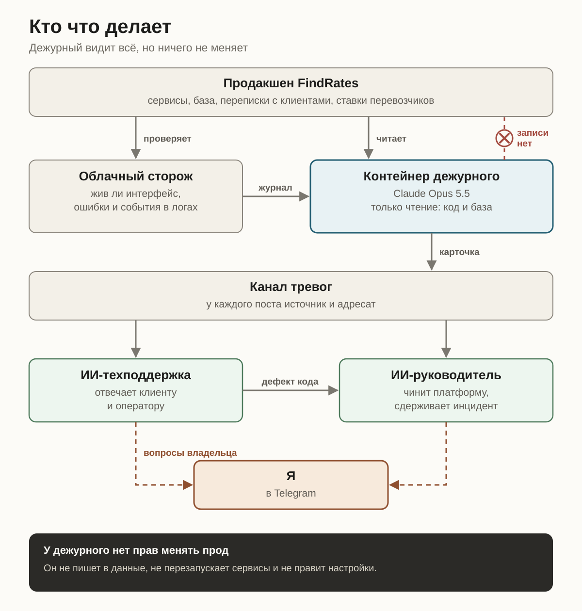
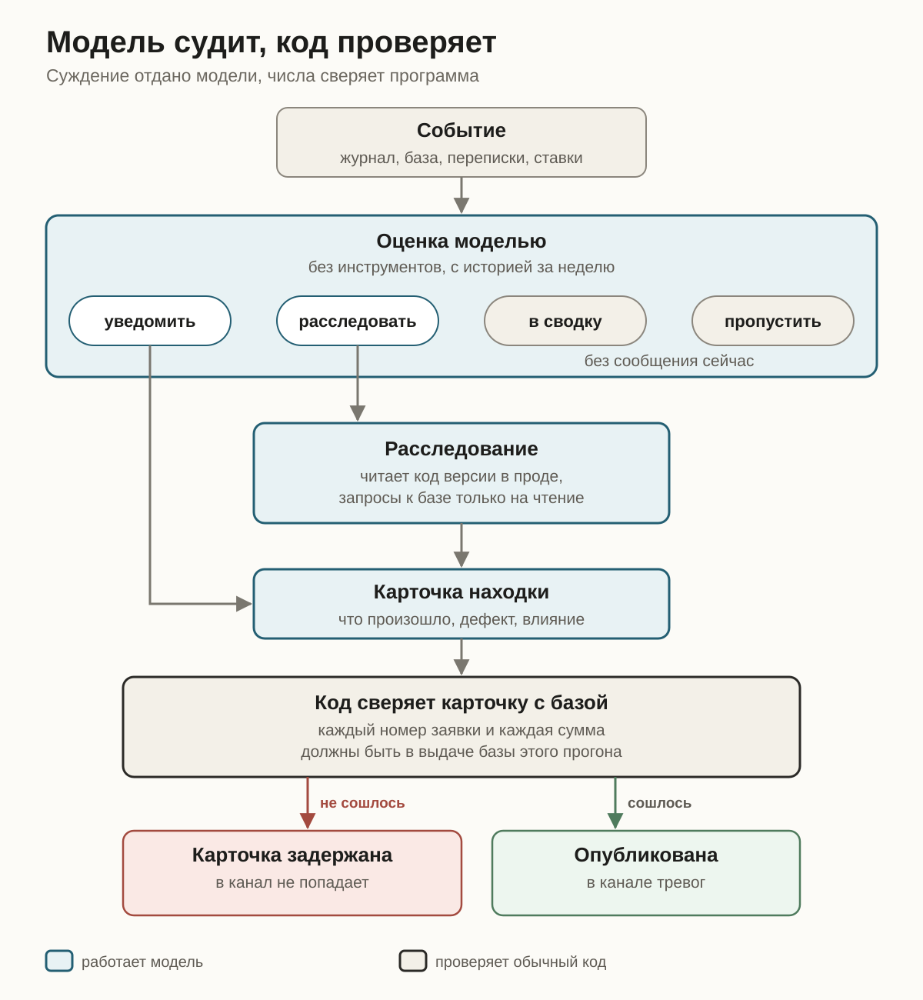
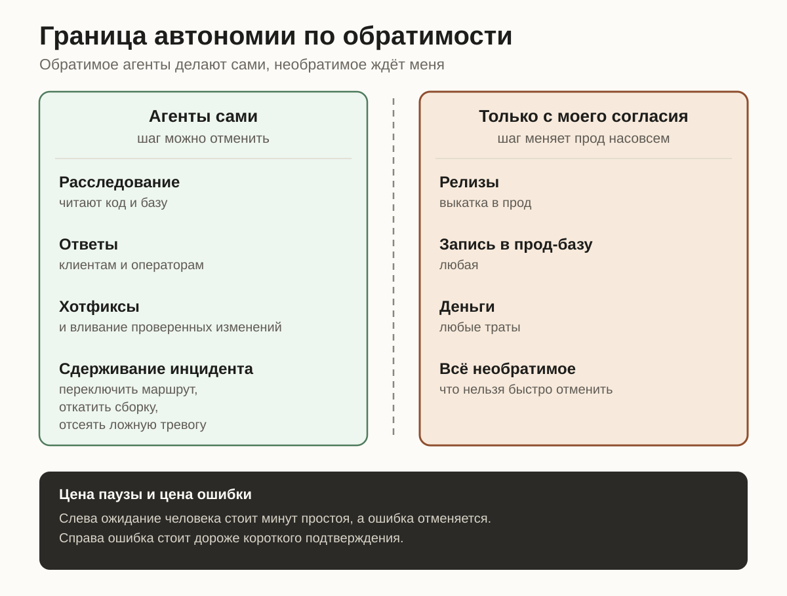
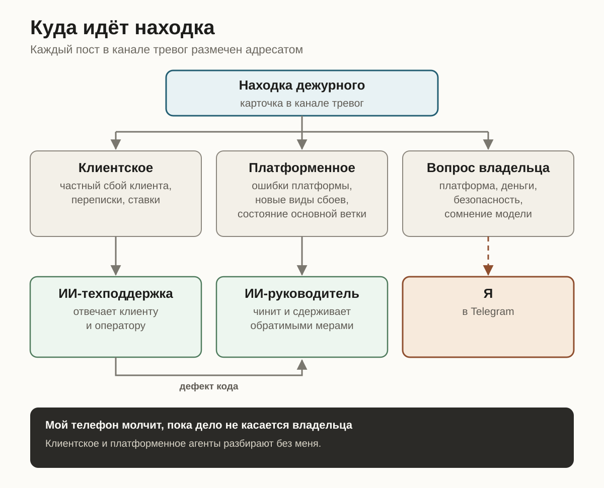

В обычном веб-сервисе авария сразу видна на графиках: растут коды ошибок, задержка ответа или очередь задач. В продуктах со сложной предметной логикой, внешними интеграциями и диалоговыми агентами самые дорогие поломки выглядят иначе. Серверы здоровы, ответы быстрые, в журнале ошибок пусто, но сделка тихо срывается по смыслу.

Я руковожу разработкой FindRates, сервиса грузовых перевозок. Клиенты пишут боту в мессенджерах и на почту, перевозчики присылают ставки письмами, сотрудники и партнёры работают в трёх веб-интерфейсах. Разовый таймаут с удачным повтором оставляет ошибку в логе, хотя процесс прошёл штатно. Зато бот, который зациклился на одном вопросе в чате, или неверно разобранное условие в ставке перевозчика вообще не дают технических ошибок и молча уводят клиента.

Пороговые алерты смотрят на числа и не видят смысла операции. Чтобы круглосуточно ловить такие отказы и закрывать рутину без ночных звонков разработчикам, нужна система, способная сверить реплику в диалоге, состояние базы и обработчик в коде. В FindRates этот контур построен на Claude Opus 5.5 и специализированных ИИ-агентах.

Разберу, из каких слоёв состоит такая система и на каких принципах строится дежурство, где ИИ следит за продакшеном и гасит сбои без риска его сломать.

## Шесть слоёв смыслового мониторинга

Контур мониторинга и реагирования делится на шесть последовательных слоёв, у каждого из которых одна задача.

**Сбор сигналов.** Одного потока инфраструктурных логов мало. Система сводит вместе проверки доступности и события деплоев, прикладные ошибки из собственной базы продукта, живые переписки с клиентами и результаты разбора входящих расценок.

Запись ошибок напрямую в базу приложения дублирует облачный сборщик логов. Когда во время крупной аварии у хостинга внешний поток логов ослеп на 22 часа, а сбой хранилища нарушил сохранение клиентских вложений (запись восстановили за 10 часов, восемь из них ушли на ожидание сборок у провайдера), чтение ошибок из собственной базы сохранило видимость продакшена.

**Первичная оценка и шумоподавление.** Отправлять весь поток в глубокое расследование дорого и бессмысленно. Сначала жёсткие правила отсеивают спокойные десятиминутные окна и известный фон. По оставшимся сигналам запускается быстрая оценка закреплённой моделью без инструментов: опираясь на историю повторов за неделю, она отделяет разовую помеху от сбоя у клиента или тихой деградации платформы (повторный провал ночного задания, рост очереди, отказ ключа, исчерпанный баланс внешнего сервиса).

**Расследование с доступом только на чтение.** Когда первичного сигнала мало для диагноза, открывается изолированный проход расследования. Модель читает снимок кода работающей в проде версии и делает запросы на чтение к боевой базе со скрытыми контактами клиентов, чтобы проверить реальные последствия для сделки.

**Маршрутизация и эскалация.** Подтверждённая находка оформляется стандартной карточкой и уходит тому звену, которое способно закрыть причину: в первую линию поддержки, в разработку или лично владельцу.

**Сдерживание и восстановление.** Агенты-исполнители отвечают пользователям, гасят активный сбой обратимыми мерами и готовят проверенные тестами исправления кода, запрашивая человека только перед необратимыми шагами.

**Разбор после инцидента.** Каждый промах продукта или самого наблюдения заканчивается системным изменением: новым инвариантом в коде, запретом в правилах разработки или пополнением проверочного архива.

## Модель судит о смысле, код держит инварианты

Частая ошибка при внедрении ИИ в эксплуатацию — держать безопасность на тексте промпта. Модель хорошо разбирает неструктурированный контекст: она видит, что клиент ждёт ставку, а бот второй раз спрашивает уже названный маршрут. Но вероятностной модели нельзя доверять соблюдение границ доступа и точность переписанных номеров.

Принцип здесь прямой: суждение о смысле отдано модели, жёсткие инварианты зашиты в обычный код.

Во-первых, контур расследования физически лишён прав на запись в базу, правку конфигурации и перезапуск сервисов. Даже на ошибочном выводе или враждебном тексте во входящем сообщении дежурный не может поменять состояние продакшена. Во-вторых, код проверяет структуру ответа и следит, чтобы вызов обслужила именно закреплённая старшая модель без подмены на облегчённую.

В-третьих, код проверяет точность фактуры в каждом отчёте. В одном из расследований модель верно нашла причину поломки в коде, но в карточке приписала внутренние заметки одной заявки к номеру другой. На длинном контексте такие перестановки неизбежны, и правками инструкции они не лечатся.

Задачу закрыл программный фильтр перед публикацией: код достаёт из текста карточки все идентификаторы заявок и суммы и сверяет их с выдачей запросов к базе за этот прогон. Любое число, не подтверждённое чтением из базы, блокирует отправку карточки.

## Граница автономии проходит по обратимости

Мониторинг, который заканчивается уведомлением в чате, переносит узкое место в телефон руководителя. Обратная крайность с полным доступом агентов к продакшену даёт неприемлемый радиус поражения. Чтобы система и реагировала за минуты, и оставалась безопасной, граница между действиями агентов и решением человека проведена по обратимости шага.

Всё обратимое и проверяемое автотестами выполняют постоянные агентские контуры: ИИ-техподдержка и [ИИ-руководитель](/articles/ai-tech-teams-lead/). Они собирают диагностику, отвечают клиентам и операторам, заводят задачи, пишут хотфиксы и прогоняют их через тесты. На активном сбое ИИ-руководитель вправе сам применить обратимое сдерживание: откатить сервис на предыдущий рабочий образ, временно изолировать сбойных адресатов или погасить подтверждённую ложную тревогу.

Всё необратимое требует моего согласия: выкатка новых релизов, любая запись в продакшен-базу, траты и изменение правил безопасности.

По разные стороны этой черты цена паузы и цена ошибки устроены противоположно. Во время сбоя ожидание человека стоит минут простоя, тогда как возврат на прошлый образ не портит данные и отменяется за минуту. Запись в боевую базу или выпуск релиза меняют состояние продукта насовсем, поэтому короткая пауза на подтверждение владельца обходится кратно дешевле автоматической ошибки.

Как работают вместе диагностика, сдерживание и последующий разбор, хорошо показал сбой на сетевой границе. Вызовы одного внутреннего интерфейса к другому стали получать отказ по частоте запросов, а монитор доступности поднял ложную тревогу о падении сервиса. В логах принимающего сервиса отклонённых запросов не оказалось, а отказы прилетали за 11–50 миллисекунд, быстрее любой прикладной обработки.

Такое расхождение сразу указывает на место поломки: трафик шёл внешним маршрутом и резался пограничным прокси хостинга ещё на подходе к приложению. Сдерживание от момента фиксации уложилось в 7 минут при общей недоступности интерфейса около 19 минут. Разбор закрепил архитектурный запрет на внешние маршруты для внутренних вызовов, обязал монитор доступности писать в лог точную причину каждого сбоя вместо смешивания лимитов частоты с падением и оставил базовое правило диагностики: сначала проверять, видел ли запрос получатель.

## Маршрутизация находок и независимый контроль над агентами

Точные алерты быстро превращаются в шум, если валить их в один общий канал. Сигнал должен приходить тому участнику, у которого есть полномочия и контекст закрыть вопрос. Каждая карточка дефекта собирается из четырёх блоков («Что произошло», «Дефект», «Влияние», «Клиенту») и несёт метку источника и целевой роли.

Проблемы конкретного клиента, застрявшие диалоги и сбои в разборе ставок уходят только в ИИ-техподдержку. Она решает вопрос с оператором или клиентом и передаёт карточку в разработку, только если за симптомом стоит дефект кода. Прикладные ошибки платформы, новые виды сбоев в логах и состояние основной ветки забирает ИИ-руководитель.

В мой Telegram выведены только вопросы уровня владельца: общеплатформенный сбой, угроза деньгам или безопасности, массовые отказы и явное сомнение модели (плюс резервный канал на случай недоступности основного рабочего чата).

Когда в эксплуатации работают несколько агентов, появляется ещё одно требование: наблюдатель должен быть полностью изолирован от тех, кто меняет систему. Общий контекст или общая память сессии у исполнителя и контролёра означают общие слепые пятна.

Однажды ИИ-руководитель с моего согласия снял внутреннюю блокировку с пакета старых почтовых адресов перевозчиков после сверки со статусами сервиса рассылки. Предпосылка оказалась неверной: отсутствие блокировки у почтового провайдера не гарантирует, что старый ящик существует.

Когда доля жёстких возвратов пошла вверх, аномалию независимо поймал изолированный контур дежурного и открыл карточку тревоги. Нерабочие адреса отключили за 40 минут, за два с половиной часа полностью вернули прежнее состояние. Отдельный контур мониторинга ловит ошибки собственных агентов наравне с багами в продукте.

## Проверка на архивах и экономика вызовов

Тишина в мониторинге обманчива: снаружи исправный продакшен не отличить от ослепшего детектора. Поэтому каждый новый смысловой проход перед запуском проверяется на исторических срезах продакшена с известными отказами.

Контроль клиентских чатов проверяли на двухдневном архиве реальных переписок, где при пустом логе ошибок лежали сорванные онбординги рекламных клиентов: зацикленные вопросы бота, пустая заявка без груза, неверно определённая роль заказчика. Детектор поднял тревогу по каждому такому диалогу в том же десятиминутном окне, где ломался сценарий, а спокойные окна отсеял предварительными правилами без вызова модели.

По той же схеме на архивных срезах проверяли недельную историю повторов для тихой деградации ночных фоновых задач, где ответы внешнего сервиса обрезались по лимиту длины без жалоб со стороны пользователей.

Двухступенчатая схема держит под контролем и стоимость. Круглосуточное дежурство старшей модели обходится в среднем в $7,65 в сутки по прайс-листу API, складываясь из коротких оценок по четырём потокам и прицельных расследований по коду и базе.

Расход не растёт линейно с трафиком по трём причинам: спокойные окна отсекаются до обращения к модели, первичная оценка стоит центы и отбрасывает шум до чтения кода, а суточные потолки по каждому виду проверок ограничивают траты в дни аварий. Дешёвые модели на ранних пробах стоили доли цента за запуск, но умели только пересказывать строки чужого лога, оставляя весь разбор человеку. Нынешняя смена оплачивает проверку живых бизнес-сценариев и готовый диагноз, сверенный с кодом и базой.

Смысловой мониторинг меняет разделение труда в разработке. Круглосуточное наблюдение за потоками, сверку симптомов с базой и кодом, типовые ответы и обратимое сдерживание ведут агенты. Задача руководителя разработки — выстроить независимые слои без единой точки отказа, закрепить инварианты в обычном коде, проверить детекторы на реальных поломках и оставить за человеком необратимые решения, за которые он отвечает сам.
